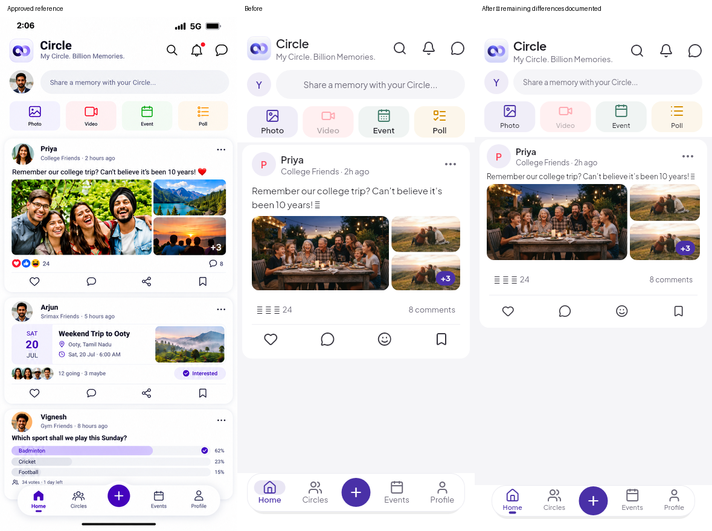

# Home visual discrepancy report

Base:31b139d68f3b43ae8f552684024e153263fa9275. Only approved-image candidate:
`mobile/design_reference/home_feed.png`, introduced/last changed in6f9f0b7. The owner explicitly reconfirmed this image
in the “Design I want” message on 3 November 2026.
`mobile/design_reference/output/home_feed_actual.png` is an older generated output.
No newer approved reference or tablet image was found in repository history.

Reference852×1846 raster normalized to393×852 logical units (x0.46127,y0.46154).
This ratio does not establish native device DPR. Current capture uses393×852,
DPR1 and synthetic OS insets24top/24bottom; native status symbols are excluded.
Matching test-only first post:Priya,College Friends, same approved sentence,
6 photos/+3,24 reactions,8 comments, fixed clock/two-hour age. Image content and
avatar pixels differ and must be masked, not scored as layout errors. Lower
reference event/poll content has no equivalent production Home data and is not
compared. All widgets remain real production widgets with injected test data.

Working tolerance:±4logical pixels for major visible bounds;48-pixel tap targets
may extend beyond smaller painted controls. Font identification/weights and
some raster bounds are estimates; typography and optical alignment require inspection.

Coordinates below use(x,y,w,h). Reference bounds are manual raster estimates;
current bounds are exact Flutter render-box measurements from before.json.

|Component|Reference visible bounds estimate|Current bounds|Position/size discrepancy|Typography/icon/color/spacing observations|
|---|---|---|---|---|
|Header logo|(16,36,39,39)|(16,32,40,40)|dy−4;size+1|Original artwork correct; title20/600 bundled PlusJakarta, reference family/weight unproven. Action icon24; reference~21–24. Optical row sits high.|
|Composer pill|(67,89,312,39)|(64,88,313,48) tap/paint|dx−3,dy−1,height+9|Input14/400 line20; reference~12–14. Preserve48hit area with smaller painted pill. Gray family close; exact gradient not inferable.|
|Photo quick action|(16,140,84,49)|(16,148,84.25,52)|dy+8;height+3|Icon24; reference~21–24. Label13/400–600 vs reference~9–12estimate. Correct action variants need inspection; Video disabled semantics retained.|
|Feed background|White/pale gray, boundary~202|Gray begins~204|Boundary near target|Existing recessed token; avoid whole-theme rewrite.|
|Post card|(7,202,379,254)|(0,208,393,362.21) outer slot|Painted container inset8/4; slot height+108|Card16radius vs~16–20. Current reaction/action touch rows and content account for excess height; do not attribute differing photos to spacing.|
|Author name|(67,214,~35,~16)|(72,224,38.08,24)|dx+5,dy+10,height+8|Current16/600 line24 appears larger; reference~13–14estimate. Avatar40 current; reference~37–40, contents masked.|
|Post content|(20,252,354,~16)|(24,276,345,46)|dx+4,dy+24,width−9;height+30|Same text wraps into2 lines at15/400 line23. Measure intrinsic text width to select Home-only type style.|
|Reactions/comments|Approx(20,402,354,22)|Comment(283.60,477.21,77.40,16)|dy~+75|48minimum touch rows must be preserved. Emoji system fallback differs; mask glyph contents and compare alignment separately.|
|Floating dock|Approx(29,777,335,51)|Home label(34.65,792,37.95,16)|Current dock wider/taller; label itself near target|All5actions retained. Reference selected glyph/underline differs from current capsule icon highlight. Native bottom inset must stay respected.|

Before capture:before.png; measured bounds:before.json. These estimates establish
what to refine; neither passing tests nor an aggregate pixel percentage constitutes
visual approval. Device screenshot's heavier text is investigated with default and
OS Bold Text modes; accessibility settings will not be disabled or clamped away.

## Final measured result

These are **improvements for review, not a claim of exact visual acceptance**.
Reference coordinates remain approximate raster measurements. Δ values compare
visible bounds, except where explicitly identified as hit/slot bounds. Logical px.

|Component|Reference (x,y,w,h), approximate|Final (x,y,w,h)|Δx / Δy / Δw / Δh|Type, icon, colour and spacing result|
|---|---|---|---|---|
|Header logo|(16,36,39,39)|(16,36,40,40)|0 / 0 / +1 / +1|Row lowered4; brand title now700. Existing Lucide24 search/bell/chat retained. Red unread dot depends on real unread state, never fixture decoration.|
|Composer paint|(67,89,312,39)|(64,87,313,42)|−3 / −2 / +1 / +3|12/400, line18, tracking0; horizontal16, vertical12. Tap bounds(64,84,313,48). Pill RGB245/245/248 vs reference sample241/243/247; subtle gradient still differs.|
|Photo tile|(16,140,84,49)|(16,140,84.25,51)|0 / 0 / +0.25 / +2|Label11/500,line15; icon24; gap4. Plain calendar and list replace calendar-days/checklist. Video remains disabled/dim; enabled reference video is intentionally different. Photo fill sample240/238/248 vs243/242/254.|
|Background|Pale near-white|Existing recessed245/245/248|Not a rectangular component|Reference outer-card sample253/253/253 is lighter and softly shaded. Kept existing token; no global palette rewrite.|
|White card|(7,202,379,254)|(8,203,377,312.07)|+1 / +1 / −2 / +58.07|Outer measured slot(0,199,393,320.07). Horizontal content inset12; top/bottom4. Radius16 retained. Height **outside tolerance** because summary/action targets remain48 each. Surface255/255/255 vs reference254/254/254 sample; shadow differs.|
|Author name|(67,214,~35,~16)|(68,212.5,33.88,20)|+1 / −1.5 / ~−1.12 / ~+4|Home-only14/700,line20; metadata12/400,line17; tracking0. Avatar40. Source font identity cannot be proved from raster. Relative age remains “2h ago” instead of reference “2 hours ago”.|
|Post content|(20,252,354,~16)|(20,255,353,18)|0 / +3 / −1 / ~+2|Home-only12/400,line18,tracking0, one line with matched text. Detail retains15/400. Media(20,277,353,126.07), reference approximately(20,270,354,125): **7px lower**, outside tolerance.|
|Reaction/comment summary|Count baseline around407|Comment box(289.55,426.57,71.45,17)|Vertical ~+20; text widths not equivalent|Summary retains48px interactive targets. Current “8 comments” vs reference bubble plus8 is a visible difference. Native emoji unavailable in this Linux renderer, shown as fallback glyphs; excluded from shape claims.|
|Post actions|Icons centred near438; smaller reference row|Row(8,463.07,377,48), centres487.07|Vertical approximately+49; height larger|Lucide21 icons, original48px buttons. Heart/comment/reaction-picker/bookmark remain functional. Reference Share action has no equivalent supported operation: reaction picker stays honestly labelled. Filled selected heart remains existing app state.|
|Floating navigation|(29,777,335,51)|(28,776,337,52)|−1 / −1 / +2 / +1|Labels11,line15; selected600, others400. Underline12×4 replaces oval. Lucide24 outlines retained; reference filled Home glyph differs. Create48 target/circle. Full text scaling, min52 dock and bottom SafeArea retained.|

## Typography, icons and accessibility inspection

`mobile/pubspec.yaml` bundles PlusJakartaSans400/500/600/700 and Roboto400/600.
The active theme and semantic styles use PlusJakartaSans; tests explicitly load
all those assets through `test/flutter_test_config.dart`. No font downloaded or
substituted, and no global typography/theme replacement. The reference has no
font metadata; its exact family, weight and line metrics cannot be certified.
The default and Bold Text/200% final renders were visually inspected. Larger body text
wraps/expands; composer can ellipsize and the existing header tagline scales down
when constrained. Those are remaining accessibility limitations; navigation no longer clamps scaling to1.3. Dock respects24px bottom
safe inset in these captures. A native iPhone comparison is still needed for OS
font rasterization, emoji, status chrome, physical images and real safe areas.

Icons remain in the existing Lucide family for these controls. Plain calendar
and bullet-list silhouettes are closer to the reference; outlined Home and the
reaction-picker glyph remain documented differences. Stroke is supplied by the
existing font; no unrelated icon library was introduced.

## Evidence and reproduction



- [Approved original](../../../mobile/design_reference/home_feed.png),852×1846.
- [Normalized approved reference](reference-normalized.png),393×852.
- [Before](before.png) and [before render boxes](before.json).
- [Final](final.png) and [final render boxes](final.json).
- [50% overlay, unmasked](overlay-unmasked.png): deliberately shows all differing content.
- [50% overlay, content-masked](stages/final-overlay.png).
- [Difference heatmap, content-masked](heatmap.png).
- [Bold Text with200% scaling](final-bold.png).
- `01-header` through `06-dock` PNG/JSON files record successive real renders;
  `stages/` contains inspected component overlays/difference images.

Masking uses the union of differing photo/avatar content regions. Unsupported
lower event/poll content is masked fromy456 to776; that region is not evidence of
a match. This also excludes overflowing final-card actions there from pixel
comparison; their absolute positions are reported above instead. Geometry is
never inferred from the masked heatmap. No aggregate similarity score is used.
The full unmasked overlay remains available to expose these limitations.

From `mobile/`, with Flutter3.44.8 and dependencies installed:

```sh
CIRCLE_COMPONENT_CAPTURE=final flutter test --no-pub test/home_reference_review_test.dart --plain-name 'normalized Home visual fixture'
CIRCLE_COMPONENT_CAPTURE=final-bold CIRCLE_REVIEW_BOLD=true CIRCLE_REVIEW_SCALE=2 flutter test --no-pub test/home_reference_review_test.dart --plain-name 'normalized Home visual fixture'
```

From repository root (Python3 and Pillow):

```sh
python3 mobile/scripts/compare_home_component.py final final
```

Acceptance remains open: major top/dock bounds are within the working±4px target;
card height, media and action positions are not. Unsupported inline event/poll
cards, Share behavior, filled Home glyph, exact fonts, colours/gradients/shadows
and native emoji remain visible differences. No static mock widgets, fabricated
production content, disabled accessibility settings or overwritten golden
baselines were used to conceal them.

## Validation results

- Dart formatting and final Flutter analysis: clean.
- Focused Home/chrome/design checks: 15 passed.
- Normalized Bold Text + 200% capture: 1 passed, no rendering exception.
- Full Flutter suite: 684 passed, 1 skipped, 22 failed. All 22 failures are golden pixel comparisons against unchanged Windows baselines; no non-golden test failure. This is not an all-green test result and requires Windows visual review.
- Real before/after/overlay/heatmap images inspected; exact visual acceptance remains open for the discrepancies listed above.
