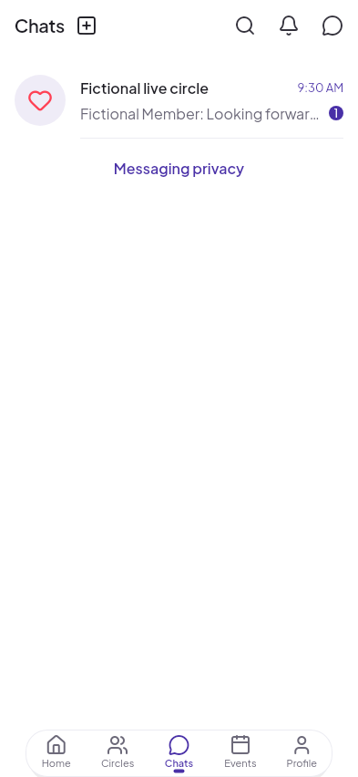
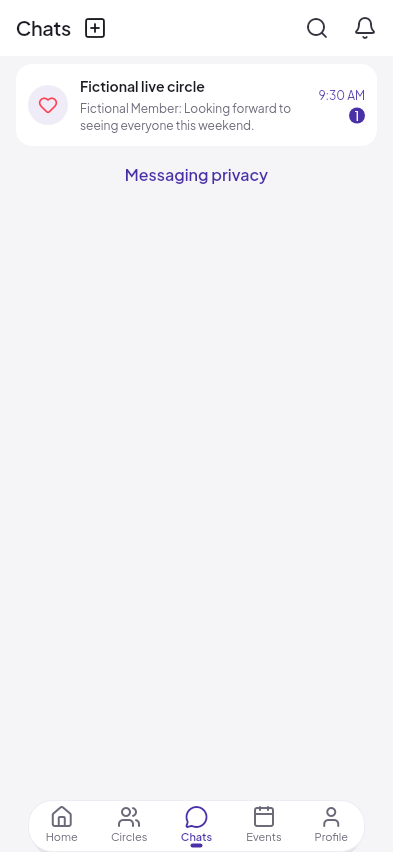
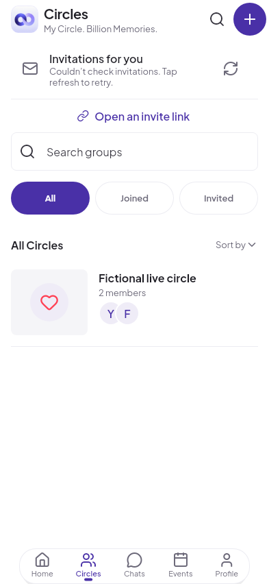
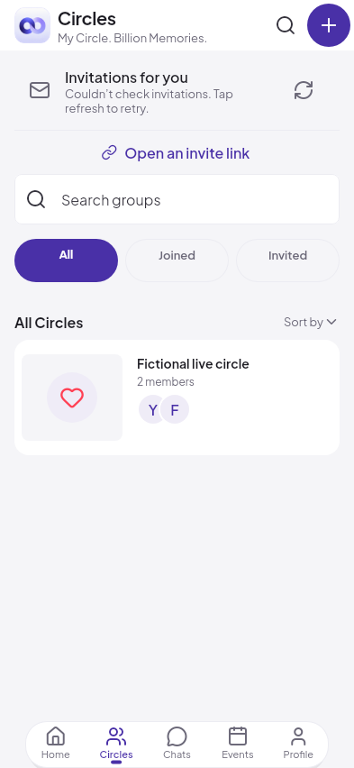
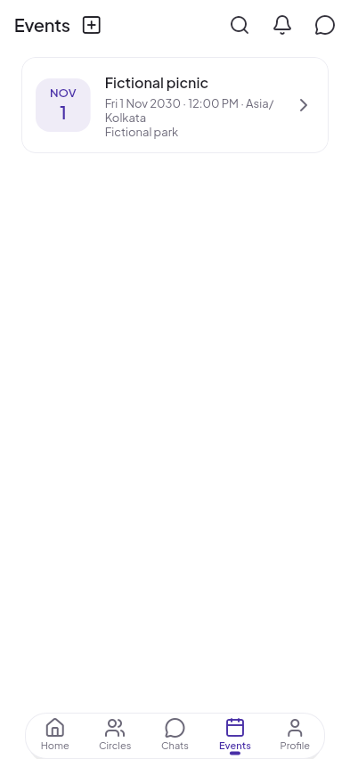
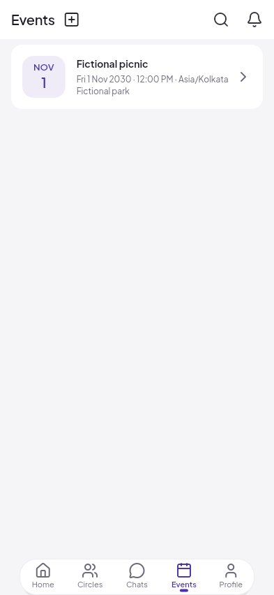
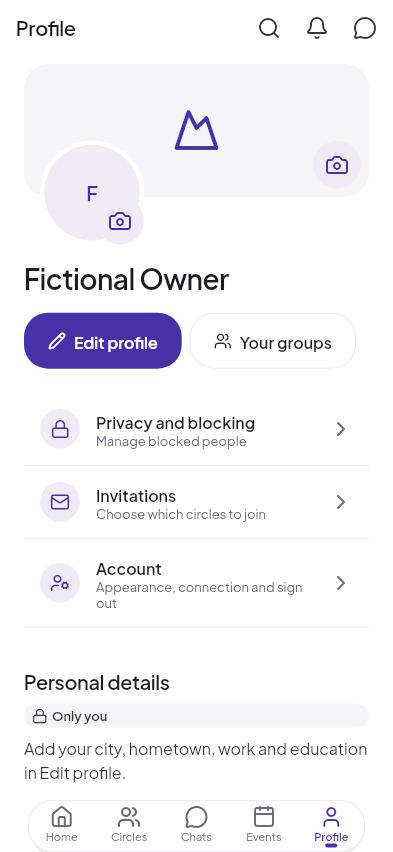
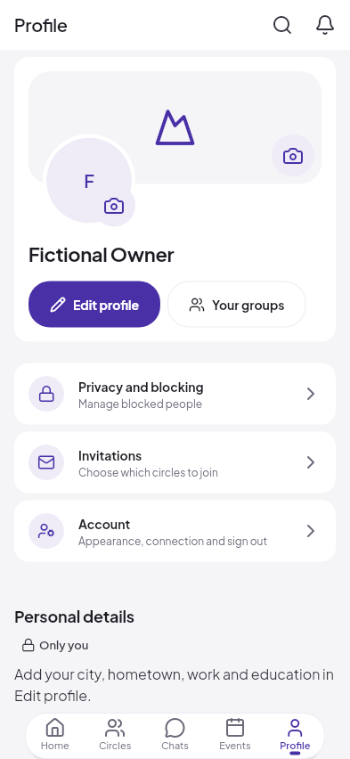

# Home style across the root pages

3 November 2026. Before source: `70455f4`. The owner's current Home styling
is applied to Chats, Circles, Events and Profile. The approved Home reference
remains `mobile/design_reference/home_feed.png`; there are no approved reference
images for these four pages, so this is a consistency review, not exact visual
equivalence or device acceptance.

## Changes

- Root headers use the existing 22px page-title role. Home keeps its brand lockup.
  Redundant Chats shortcuts disappear from the other root headers; the center
  Chats tab and the New chat header action remain.
- Root lists share Home's pale canvas, rounded white surfaces, compact title and
  metadata roles, 16px side insets and 8px card gaps. Colors follow the dark theme.
  The new `CircleSurfaceCard` reuses existing tokens rather than inventing a theme.
- Chats retains its real previews, unread counts, mute/pin states and avatar
  sources. Larger text stacks metadata beneath the preview and wraps full names
  and messages. Conversation bubbles, permissions, photo handling and composer
  behavior remain as implemented.
- Circles keeps search, filters, nesting, collapse controls and navigation. Its
  list items become cards; large-text filter pills wrap as whole controls.
- Events keeps date badges, covers, titles, venue, cancellation status and
  existing detail/RSVP/create flows, with Home's card and typography treatment.
- Profile has a rounded cover/identity card, compact action pills and separate
  settings/detail cards. Private field labels and existing photo/edit actions remain.
- The dock keeps Home / Circles / Chats / Events / Profile. It uses more available
  width at large text sizes; labels remain one line and may ellipsize on a narrow
  phone. Full destination names remain in semantics. No text scaling is clamped.

## Same-fixture before and after

Real Flutter renders at 393×852 logical pixels, DPR 1, with fictional test data.
The Circles fixture intentionally cannot load its invitation count; the retry
state is real and appears on both sides. Missing covers use existing placeholders.

| Page | Before | After |
|---|---|---|
| Chats |  |  |
| Circles |  |  |
| Events |  |  |
| Profile |  |  |

Twenty after captures cover all four pages at phone light/dark, narrow phone
dark/200% text, tablet light, and tablet dark/200% text. Representative phone,
dark, narrow and tablet captures were visually inspected. No rendering exception
was observed. This does not establish native font/emoji/photo-picker behavior.

Reproduce from `mobile/`:

```sh
CIRCLE_CAPTURE_ROOT_STYLE=true flutter test test/root_style_review_test.dart
flutter test test/chrome_review_test.dart test/live_chat_events_test.dart \
  test/you_profile_test.dart test/design_system_guard_test.dart
flutter analyze
flutter test
```

## Verification

Formatting and analysis are clean. The initial focused suite passed 41 tests;
after the last chat-wrapping refinement, 37 focused tests and all five final
root-page capture checks passed. Final full suite: 689 passed, 1 skipped,
22 golden pixel comparisons failed; no non-golden failures. This is not a green
full-suite result. Windows screenshot baselines were not replaced on Linux.
No backend, API, signing identity, app version or release artifact was changed.
A new application build and physical phone/tablet review are still required.
