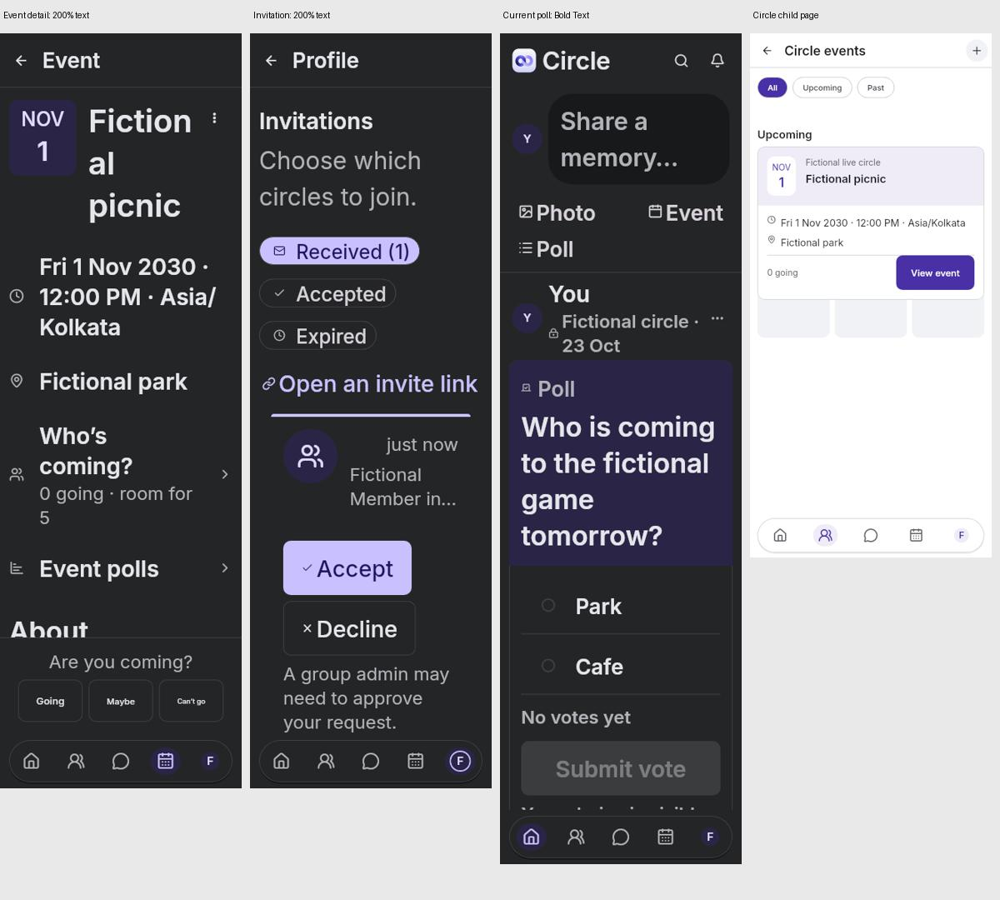

# Circle UI audit — 7 November 2026

Circle needs a consistency and accessibility pass before another redesign. The approved Home header, icon-only floating navigation, and shared Memories/Poll/Event cards provide a useful direction. Secondary pages still vary in density, form treatment, identity layout, and recovery states. Several visible problems affect decisions and readability.

This is an audit of current repository UI, not a review of an installed production build. No application code, backend, SQL, download, or release configuration changed.

## Evidence and method

- Source: `aaa78b9` on `main`, safely pulled before inspection.
- Product Design audit plugin/framework used for screenshot-grounded UX and accessibility review. Hugeicons MCP consulted for navigation/action concepts; the existing Lucide family remains appropriate. An icon-library migration would not solve the observed issues. Stitch was not connected or used.
- Fresh Flutter renders with fictional fixtures: **59 named screens/states in four layouts = 236 captures**, plus **23 current Poll/Event feature captures = 259 reviewed captures**. Layouts cover 393px phone light/dark at 100%, 320px narrow dark at 200%, and 900px tablet light at 200%. Feature variants additionally cover narrow light, Bold Text, populated creation fields, and six listing surfaces. Heights vary by harness.
- Four focused visual suites passed **28 tests**. A temporary diagnostic harness passed **2 tests** and generated seven additional captures. These seven lack font initialization and do not reliably establish the intended overlay state: **diagnostic only**, excluded from typography/menu conclusions. They reproduce the child-page layering after a five-second wait. A passing harness is not proof of complete interaction coverage.
- Total saved: **266 PNGs**. All reviewed main captures were inspected in contact sheets; priority issues were inspected at full size. Original captures, hashes, contact sheets, logs, and the diagnostic harness are retained below.
- Error/empty/capability-disabled fixtures assess the presentation of those states. They do **not** demonstrate live outages. Bundled placeholder imagery in showcase fixtures is not evidence of a production photo failure.

[Priority comparison](design-previews/ui-audit-2026-11-07/audit-priorities.jpg) · [Original captures ZIP](design-previews/ui-audit-2026-11-07/captures.zip) · [Capture manifest](design-previews/ui-audit-2026-11-07/capture-manifest.csv)

## Highest-priority findings

| Priority | Finding and evidence | Recommended change |
|---|---|---|
| P1 | Enabled unselected radio/checkbox outlines are too faint. Dark Poll options visibly disappear into their surface (`extra/poll-refined-bold-320-2.0-true.png`). Shared checkbox/radio themes use the decorative hairline token. | Add an accessible interactive-outline token. Keep quieter dividers separate. Verify enabled, selected, focused, and error states in both themes. |
| P1 | Event detail squeezes the title beside the date badge: “Fiction / al / picnic” at 320px/200%. RSVP labels become tiny despite enlarged surrounding text (`-events-e-91-320-2.0-dark.png`). `live_events.dart` uses `FittedBox(scaleDown)` for these labels. | Reuse the Event card's responsive date/title arrangement in detail. Stack/wrap RSVP actions at large text instead of shrinking their text. |
| P1 | Invitation detail presents Accept/Decline while the Circle identity becomes unreadable at 200%; the page header says “Profile” (`extra/secondary--you-invitations-12-320-2.0-dark.png`). | Give invitations a correct route title; place the full Circle name above inviter/time, with decisions below. Keep identity readable before asking for acceptance. |
| P1 | Circle child pages show parts of the underlying Circle layout behind their own content (`-groups-g-3-events-393-1.0-light.png`; similar settings/invite captures). Diagnostic renders retain the layering after navigation settles for five seconds. | Inspect shell/child route ownership and provide an opaque semantic page surface. Verify back navigation and scrolling; do not cover the symptom with extra spacing. Confirm on a device after fixing. |
| P2 | Form fields and submission layouts differ across New Event, New Poll, New Circle, Edit Profile, and account/auth pages. | One shared form specification for labels, base surface, field height, spacing, helper/errors, keyboard behavior, and primary action placement. Preserve the approved Event sections. |
| P2 | Error, empty, and retry states look unrelated across sessions, invitations, chat privacy, reports, and search. | Shared state component with a short title, useful message, and one recovery action, retaining already-loaded content where possible. |
| P2 | Type hierarchy and action styling drift between newer cards and older secondary screens. | Consolidate text roles and header actions rather than changing the font package again. Verify native Apple text and Inter separately. |

### Contrast calculation

The shared theme uses `#CED0D4` hairline on white in light mode and `#3E4042` on `#242526` in dark mode. Standard sRGB relative-luminance calculation gives approximately **1.54:1** and **1.47:1** respectively. Enabled control boundaries needed to identify a control generally require **3:1** against adjacent colours under WCAG non-text contrast. These figures describe the shared token pairs, not every antialiased pixel or every control surface. Disabled buttons are not being judged as enabled controls, and this is not a WCAG compliance certification.

Source anchors: `mobile/lib/core/design.dart` checkbox/radio themes near lines 609–623; `mobile/lib/features/events/presentation/live_events.dart` near line 241; `mobile/lib/app/circle_experience.dart` `circleDetailTitle` handles `/you/invitations` but not its ID child path. `ReadingPane` constrains width without supplying a page background; nested route surface ownership needs inspection before choosing the layering fix.

## Screen-by-screen assessment

Each numbered step groups the relevant screens and UI parts. Screenshot names below refer to entries in the ZIP/manifest; root captures use route-like filenames and secondary captures live under `extra/`.

1. **Welcome, login, registration — needs refinement.** Core actions are recognizable and inputs follow familiar conventions. Welcome has too many reassurance badges and competing explanations; “Heirloom Quality” and age-range accessibility claims add little practical value. Use one clear private-Circle promise, fewer claims, and a shorter hierarchy. Check persistent labels and long mobile-number/password labels at 200%. Evidence: `extra/auth---*`, `extra/auth--login-*`, `extra/auth--register-*`.
2. **Home header, composer, floating navigation — mostly coherent.** Preserve the approved flat header and centered icon-only dock with real profile image/fallback and active lavender state. At 200%, the composer and action row reflow substantially; verify reading order and avoid a label falling into an unintended third row. Keep accessible names/tooltips despite hidden tab labels. Search, notification, create, and settings actions should follow one size/shape policy. Evidence: `-home-*`, `extra/photo--home-*`, `extra/poll-refined-bold-*`.
3. **Memories cards, detail, photos, viewer, reactions/comments/save — coherent base, targeted polish.** Shared post identity, inset rounded media, outlined count actions, and separators are a better foundation than independent page-specific cards. Preserve actual counts and private scope. Distinguish regular body copy from short-post emphasis consistently. The comment composer can show “?” despite a known signed-in identity: `memory_detail.dart` passes an empty name to its small avatar. Use the same session name fallback as elsewhere. Native media loading, zoom gestures, and two-person comment/reaction updates remain unverified. Evidence: `extra/photo--home-memory-table-*`, `extra/photo--photos-*`, `-home-memory-*`, latest card detail captures. Additional overlay probes are inconclusive; no menu acceptance claim.
4. **Circles list/tree, creation, pending membership, Circle detail — mixed.** The selected identity/actions and explicit ownership are a strong direction. Keep actions adaptive with complete labels rather than returning to six cramped circles. New Circle has more explanatory material and a different field treatment than the Event form. The tablet tree's two-pane structure is intentional; sparse content alone is not a defect. Evidence: `-groups-*`, `extra/photo--groups-*`, `extra/secondary--groups-new-parent-*`.
5. **Circle secondary pages: Members, InCircles, events, invite/link, settings, reports — needs correction.** Child-page layering is the main visual defect. Standardize page title/action treatment and list metadata. Keep members/role information scannable without making every metadata row resemble primary navigation. Reports' empty/retry layout should match other states. Albums with its capability disabled has little useful body content; if a deep link reaches it, show an honest unavailable state and a way back. Unsupported features should remain hidden. Evidence: `-groups-g-3-events-*`, `-groups-g-3-settings-*`, `-groups-g-3-invite-*`, `extra/secondary--groups-g-3-*`.
6. **Poll creation, list, voting detail, voters, embedded cards — improved, accessibility correction needed.** The current compact lavender ballot shell now aligns with Event cards, with one embedded post menu and consistent question/option hierarchy across Home, Circle, Profile, Saved, and detail. It no longer resembles the oversized screenshot supplied earlier. Fix faint unselected controls first. Keep vote submission and privacy information quiet but readable; do not suppress system Bold Text to make the card smaller. Check long questions/options and results at 200%. Evidence: `extra/poll--*`, `extra/poll-card-*`, `extra/poll-refined-bold-*`.
7. **Events list, creation/edit, detail, attendees, embedded cards — good cards/form; detail needs work.** Date tile, lavender identity region, and clear “View event” are consistent across listing surfaces. Separate date/time and When/Where are useful. The standalone detail has not inherited the responsive title layout and scales down RSVP text. Avoid repeated “Edit event” headings and make timezone information subordinate while keeping it available. Evidence: `-events-*`, `extra/event-card-*`, `extra/event-form-*`, `extra/event-list-*`.
8. **Chats inbox, new chat, direct/group threads, pending requests, messaging privacy — usable structure, needs consistency.** Existing bubbles and bottom composer are familiar; sparse conversations legitimately leave whitespace. At large text, constrained bubble width makes messages excessively tall; revisit width rules with metadata wrapping. Long recipient identities need a full accessible name and a way to view the complete identity. “Search loaded chats/people” exposes an implementation limit in the main label; improve wording while preserving honesty about search scope. Check privacy controls' contrast and give recovery states the shared treatment. Evidence: `-chats-*`, `extra/direct-*`, `extra/secondary--chats-*`.
9. **Own/member profile, edit profile, Saved, privacy — needs visual alignment.** Shared Memories cards now carry across correctly. Identity sections, edit/message controls, cover controls, and personal-detail spacing still use different emphases. Use one profile identity layout with role-specific actions. Edit Profile should use the common form system and primary-action placement. Do not invent follower metrics or add decorative statistics. Evidence: `-you-*`, `-people-*`, `extra/photo--people-*`, latest `*-profile-*`/`*-saved-*` card captures.
10. **Invitations, valid/invalid links, accepted/pending states — priority identity fix.** Received/Accepted/Expired controls and explicit approval explanations are useful. Correct the ID-route header and make Circle identity readable before Accept/Decline. Invalid-link recovery should be consistent with other unavailable states. Evidence: `-you-invitations-*`, `extra/secondary--you-invitations-*`, `extra/photo--invite-*`.
11. **Account, password, devices/sessions, notifications — consistency and accessibility work.** Preserve clear account controls and session revocation intent. Persistent labels should survive long text; placeholders alone are insufficient. Standardize bare errors versus boxed errors and isolated Refresh actions. Notifications were reviewed as the real settings component with fake coordinator/settings, not a full native permission flow. OS permissions, background delivery, and revocation enforcement were not tested by this audit. Evidence: `-you-account-*`, `extra/secondary--you-account-sessions-*`, `extra/notifications-component-*`.
12. **Search, capability-gated activity, cross-app loading/error/empty states — partially evidenced.** Search's initial help state needs the same type/spacing hierarchy as other secondary screens. Activity's unavailable state is honest; a disabled fixture does not establish that the production bell is broken. Loading skeletons should have an opaque owning page and a stable replacement/error state. Actual production request timeouts and image throughput require a separate live investigation. Evidence: `-search-*`, `extra/secondary--activity-*`, state captures throughout the set.

## Shared design rules to consolidate

- **Typography:** keep native Apple system text on Apple platforms and correctly named Inter elsewhere. Define a practical hierarchy (roughly 21–22 page, 18 section, 15–16 body, 12–13 metadata, 14–15 actions at default scale) through existing tokens, then test scaling. Regular body, semibold emphasis; avoid making explanatory paragraphs compete with titles. These are proposed roles, not authorization to override every approved card size.
- **Backgrounds:** preserve white page canvases in light mode and semantic dark surfaces in dark mode. Use tinted containers for selected/meaningful content, not as a substitute for route backgrounds. Fix layer ownership before cosmetic colour changes.
- **Forms:** standard labels, vertical rhythm, helper/error placement, optional sections, focus treatment, and keyboard-accessible submission. Retain clear selected states and errors.
- **Icons/actions:** keep one icon family, consistent stroke/size, 48px interactive targets, and clear destructive styling. Reserve tonal/filled shapes for meaningful hierarchy rather than applying them inconsistently to identical header actions.
- **States:** one coherent loading/empty/error/unavailable vocabulary; one clear recovery action. Keep unsupported capabilities honest and avoid technical implementation wording in primary labels.
- **Identity:** reuse author/avatar fallback, Circle identity, profile identity, date/title, and role metadata components. Ensure large text does not remove the identity needed for a decision.

## Recommended delivery order and acceptance

1. Correct enabled control contrast, child-page surfaces, Event detail/RSVP reflow, and invitation identity/header. Acceptance: readable at 320px/200% in both themes, no underlying page showing, correct route titles, no text scale-down in RSVP labels, measured enabled-control contrast.
2. Consolidate form components, page titles/actions, retry/empty/loading states, and avatar fallback. Acceptance: compare the same controls across auth, Circle, Poll, Event, Profile, and Account; test keyboard/focus and validation on actual devices.
3. Polish chat widths/identity, profiles, welcome copy, and secondary metadata. Preserve the selected Home/header/dock/card direction. Acceptance: representative real-content iPhone/Android walkthrough with photo/no-photo, short/long content, Bold Text and large accessibility text.
4. Verify the release artifact matches the reviewed source before judging the installed design. Review live images, requests, permissions, and two-user interactions separately; render fixtures cannot establish those behaviors.

## Evidence index and limits

- Light contact sheets: [1](design-previews/ui-audit-2026-11-07/light-1.jpg), [2](design-previews/ui-audit-2026-11-07/light-2.jpg), [3](design-previews/ui-audit-2026-11-07/light-3.jpg), [4](design-previews/ui-audit-2026-11-07/light-4.jpg), [5](design-previews/ui-audit-2026-11-07/light-5.jpg).
- Dark: [1](design-previews/ui-audit-2026-11-07/dark-1.jpg), [2](design-previews/ui-audit-2026-11-07/dark-2.jpg), [3](design-previews/ui-audit-2026-11-07/dark-3.jpg).
- Narrow 200%: [1](design-previews/ui-audit-2026-11-07/large-1.jpg), [2](design-previews/ui-audit-2026-11-07/large-2.jpg), [3](design-previews/ui-audit-2026-11-07/large-3.jpg).
- Tablet 200%: [1](design-previews/ui-audit-2026-11-07/tablet-1.jpg), [2](design-previews/ui-audit-2026-11-07/tablet-2.jpg), [3](design-previews/ui-audit-2026-11-07/tablet-3.jpg).
- Latest cards/forms and diagnostic-only overlays: [1](design-previews/ui-audit-2026-11-07/final-1.jpg), [2](design-previews/ui-audit-2026-11-07/final-2.jpg), [3](design-previews/ui-audit-2026-11-07/final-3.jpg). Black block text in seven extra diagnostic captures is the harness default font, not an app font defect. Reaction/discard/menu probes do not establish all intended overlay states; treat those as coverage gaps.

Not verified: installed iPhone/Android rendering, screen readers, physical hit accuracy, native keyboard avoidance/focus, all menus/dialogs at all sizes, native photo/contact/share sheets, push permission/delivery, every populated backend state, real-network image speed, production failures, and all long-data combinations. The 259 reviewed renders support a broad source-level UI audit; they do not mean every possible state or every interaction has been tested. No live accessibility compliance, production authentication, backend correctness, or native acceptance claim is made.
