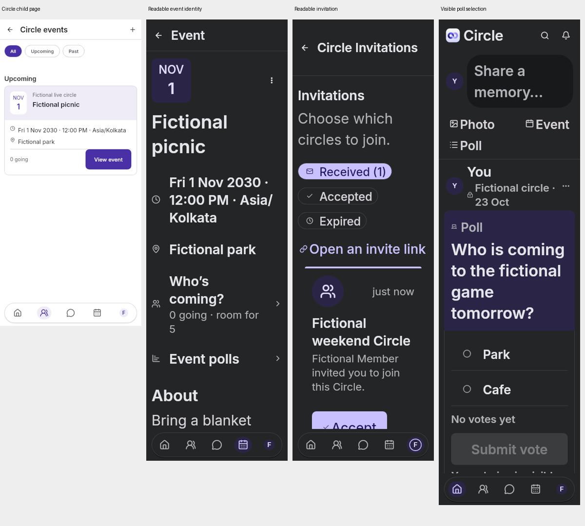

# UI audit corrections — 7 November 2026

Implements the source-level findings from [the audit](ui-audit-2026-11-07.md), retaining the approved Home header, icon-only navigation and shared Memories/Poll/Event cards. Interface marker Social 2.5; candidate version 1.0.37+43. Client-only: no backend, SQL, capabilities or authorization changes.

| Audit area | Implemented correction |
|---|---|
| Controls | Dedicated interactive outlines separated from decorative hairlines; enabled radio, checkbox and field boundaries checked at ≥3:1 on page, recessed and ballot surfaces in both themes. |
| Nested pages | Opaque route/ReadingPane surfaces and individually clipped Circle shortcut Material. A pixel regression checks that Circle tile ink cannot appear beneath its Events child after navigation settles; Back remains functional. |
| Events | Shared responsive date/title/menu identity; RSVP labels retain full text scaling and wrap. At large text, actions scroll after details instead of consuming the viewport. Duplicate Edit event heading removed. |
| Invitations | Correct ID-route title; full-width wrapping Circle identity, inviter and time with Accept/Decline preserved. Retry action belongs to the error state. |
| Forms | Shared persistent wrapping labels on 31 text/select inputs across auth, Circle creation/settings, Poll creation, Event creation/edit/RSVP, profile and password. Preserve validators, focus, autofill, counters, values and existing submission services. Neutral base fields; purposeful date/time tint retained. |
| Headers/type | Flat default header actions,48px targets, more accurate large-text title height, no empty introduction paragraphs. Existing native Apple/Inter font policy and system Bold Text preserved. |
| Chat | More readable message width at large text; full wrapping conversation identity; concise search labels with truthful search-scope helper text. Privacy errors scroll and use consistent recovery. |
| Profiles | Aligned member identity with personal-profile sizing, concise Message action with full semantic recipient, known viewer-name fallback in comment avatars. Edit Profile drops a repeated section title. |
| States/settings | Consistent error/action grouping in invitations, devices, reports and messaging privacy; readable session-card hierarchy; shared search empty state. Already-loaded device content remains available on refresh failure. |
| Unsupported pages | Albums deep links show an honest unavailable state and working way back; capability gates remain closed. |
| Welcome | One illustration, short promise, account/login actions; removed decorative quality/member-count badges and unsupported age-range claims. Enlarged the small privacy note after the contrast guideline exposed weak rendered legibility. |
| Navigation/cards | Approved dock, Home/header/card geometry, real actions/counts/privacy and private image behavior retained. No new icon family or font download. |

## Verification

- Initial focused suite:56 passing checks, including four-layout route renders, Poll/Event cards, design guard, form layout, account security and profile photos.
- Added regressions for control contrast, settled child-page pixels/back navigation, persistent-label semantics at200%, and invitation route title.
- Updated two existing UI flow tests to locate inputs below persistent labels; their keyboard/submission expectations remain intact.
- Local broad run:805 passed/1skipped/2 failures captured before the final welcome/field-finder corrections. Final affected suites:23 passed, including welcome accessibility, keyboard reachability and the four new regressions. Analyzer clean; Dart format257files clean; font identity check passed. Full Windows refresh workflow42366720525 succeeded on application source1e23d24; Run tests and artifact upload both succeeded. Exact log counts and generated Windows image review/import remain blocked by the environment network allowlist. Existing Windows baselines are retained; a normal comparison after review/import is still pending. Windows baselines must not be generated on Linux.

## Limits

Flutter renders and fictional service fixtures do not verify an installed iPhone/Android build, screen readers, real-network images, production latency, native photo/contact sheets or push delivery. A capability-disabled screenshot is not evidence of a live outage. Publishing source is distinct from deploying the backend or installing a new client. Release receipts, if produced, are recorded separately.

## Final visual evidence

Final source render run:32checks passed;259fresh captures(59named states ×4 layouts plus23Poll/Event variants). Selected full-size evidence and contact sheets are committed; the manifest records all original PNG hashes. Originals remain in the task capture directory; fixtures/capture tests can reproduce them.

[Capture manifest](design-previews/ui-audit-completed-2026-11-07/capture-manifest.csv).

Phone light: [1](design-previews/ui-audit-completed-2026-11-07/light-1.jpg), [2](design-previews/ui-audit-completed-2026-11-07/light-2.jpg), [3](design-previews/ui-audit-completed-2026-11-07/light-3.jpg).

Phone dark: [1](design-previews/ui-audit-completed-2026-11-07/dark-1.jpg), [2](design-previews/ui-audit-completed-2026-11-07/dark-2.jpg), [3](design-previews/ui-audit-completed-2026-11-07/dark-3.jpg).

Narrow200%: [1](design-previews/ui-audit-completed-2026-11-07/large-1.jpg), [2](design-previews/ui-audit-completed-2026-11-07/large-2.jpg), [3](design-previews/ui-audit-completed-2026-11-07/large-3.jpg).

Tablet200%: [1](design-previews/ui-audit-completed-2026-11-07/tablet-1.jpg), [2](design-previews/ui-audit-completed-2026-11-07/tablet-2.jpg), [3](design-previews/ui-audit-completed-2026-11-07/tablet-3.jpg).

## Release and remaining verification

- Signed Android1.0.37(43),Social2.5 built in138.6seconds with the established39+ signing certificate. ZIP/signature/package/version/SDKs verified; all three AOT libraries contain the new marker and production API; bundled Inter assets match source. Immutable APK, metadata and both download buttons updated together. Full public repository download returned200 and matched65,124,717bytes/SHA256; hosting deployment is separate. [Receipt](mobile-release-1.0.37-android.json).
- Additional large-text RSVP regression:5checks pass in the final audit regression file. The test scrolls to the lazy action, verifies inherited text scaling/no FittedBox, taps Going and verifies the service fixture saved it. [Capture](design-previews/ui-audit-completed-2026-11-07/large-event-rsvp-reachable-320-2.0-light.png).
- Signed iOS/TestFlight workflow42367416076 triggered from the same runtime source; completion/Apple processing are separate and not yet verified.
- Remaining Windows work: download/review the22 generated images, import only reviewed changes with checksum verification, then run the ordinary comparison suite. Direct artifact/log downloads returned403 for `productionresultssa8.blob.core.windows.net` and `results-receiver.actions.githubusercontent.com`, both outside this environment’s allowed domains. No baseline was generated locally or silently replaced. Owner asked to allow these hosts; production hosting/device verification also remains separate.
